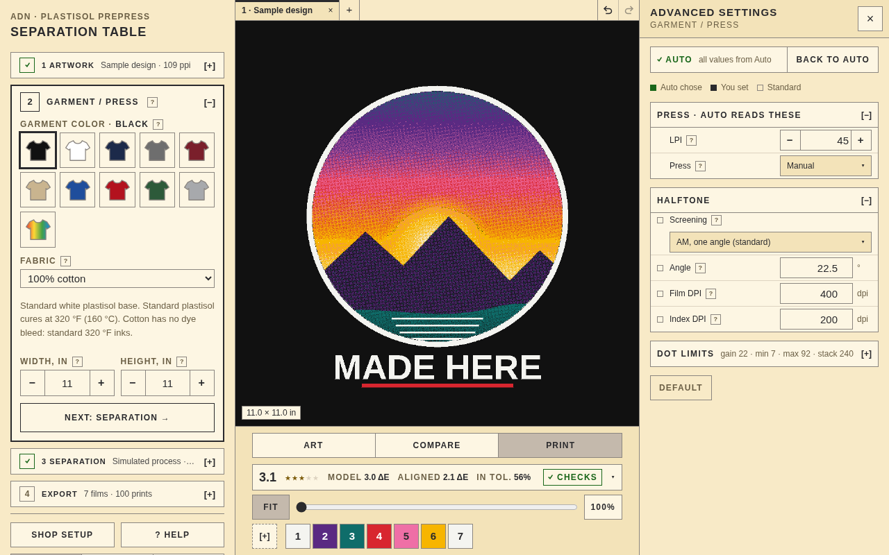

<picture>
  <source media="(prefers-color-scheme: dark)" srcset="src/assets/brand/header-dark.svg">
  
</picture>

# Separation Table

Free, open-source color separation for screen printing.
Runs in your browser.

**[Open Separation Table](https://americandreamnetwork.us/tools/textile-services/screen-printing/separation-table)**
· MIT License · © American Dream Network

Version 0.1.0 · [Changelog](CHANGELOG.md) ·
[Release notes](releases/0.1.0.md)

## What it does

Separation Table makes films for screen printing from your art.
Put in a picture or a logo. Select the shirt color. Push Auto.
You get one film for each screen, a print preview, and a list
of problems to fix before you burn screens.

<picture>
  <source media="(prefers-color-scheme: dark)" srcset="docs/screenshot-dark.png">
  
</picture>

## Features

### Films

- Simulated process, spot color, index, CMYK and 1 to 3 color
  jobs.
- A white underbase for dark shirts, choked at film
  resolution. Highlight white: Auto, On or Off.
- Halftone films: LPI, angle, dot gain, smallest and largest
  dot. Mesh follows the LPI.
- Screening at one angle (22.5° default), rotated angles,
  interlocked, or index (square pixels).

### Auto

- Auto picks the method, the number of screens, the print
  order and the settings for your art.
- If you pick a method, Auto keeps it and tunes it.
- You can change each setting after Auto.

### Inks

- Five starting ink sets, all approximate, or your own as
  `name,L,a,b` or `name,#hex` CSV.
- Inks from your shelf or from the art's own colors.
- Add, delete and reorder screens and see the effect.

### Checks

- File and film checks before you print, with one-tap fixes.
- The out-of-gamut check names the colors your inks cannot
  print.
- Color targets: the colors a customer asked for, checked
  against your inks with ΔE CMC(2:1) tiers. No PANTONE® data.

### Outputs

One ZIP for the job:

- a 1-bit TIFF for each screen, in print order;
- a true-size film PDF with register marks and a test strip;
- EPS films, and SVG for spot plates;
- a Multichannel Photoshop file, one named spot channel per
  screen;
- a job sheet, an ink mix sheet and `proof.png`, the Print
  view the customer approves;
- `separation.json`: every screen, its mesh, coverage and
  settings, and the version that made it.

### Art prep

Noise reduction, art adjustment sliders, embedded ICC
profiles, and AI tools on the CPU: background removal, 2×
upscale, click-to-select a region.

### Jobs

- Job tabs above the workspace: one tab is one job. Up to 12
  jobs stay open, and all of them come back after a reload.
- Undo and Redo for each job.

### CLI (experimental)

`sep`, a command-line tool, runs the page's own engine. It is
experimental: flags can change. See CLI below.

## Workflows

### Art program (Photoshop, Illustrator, Affinity)

1. Prep the art at print size: flat colors flat, no JPEG
   noise (or push Reduce noise here).
2. Separate here, then download the ZIP.
3. Open the `.psd` in Photoshop. It is Multichannel: one spot
   channel per screen, in print order, named and colored.
4. Change a channel by hand if you need to. Print the films
   from Photoshop or send the file to your RIP.

The file has no RGB or CMYK channels, so neither a RIP nor
Print Separations can print the art as extra plates. Turn on
"Also a preview with the art" for an RGB copy to look at.

### RIP hot folder

Push **Save into a folder** and select your RIP's hot folder
(Chrome and Edge). The files land one by one, films in print
order, and the RIP prints them. No ZIP.

### Calibrate to your press

Export the chart. Print one film per screen on the production
shirt. Measure each patch (D65/10°) and import
`ink,tint,L,a,b`. The ink model fits your press.

## Run it locally

Needs Node 22 or newer.

```bash
git clone <this repository>
cd separation-table
npm run setup   # pinned libraries and models into src/vendor/, src/models/
npm start       # http://localhost:8369
```

`npm run setup` checks each file against `src/vendor.sha256`. The
2× upscale model is built, not downloaded:
`python3 -I scripts/export-sr-model.py` (needs torch; versions in the
script). Without it, only Upscale 2× is missing.

## CLI (experimental)

`sep` runs the page's own engine in Node (job.js holds the settings, film rendering and job ZIP for both). Needs `npm run setup` once; PNG is read with the standard library, JPEG and WebP only if `sharp` is installed.

```bash
node src/cli/sep.mjs convert art.png --garment black --mode sim --screens 6 --lpi 45 --dot round -o job.zip
node src/cli/sep.mjs convert art.png -o job.zip -o films.pdf -o proof.png -o job.json   # outputs by extension
node src/cli/sep.mjs convert job.json -o job.zip   # a job file reopens to the same separation
node src/cli/sep.mjs convert new-art.png --spec separation.json -o new.zip   # same inks, same order
node src/cli/sep.mjs check art.png --platen 16x18 --check-limits min-ppi=250,small-screen=1 --json   # exit 0 clean, 1 warnings, 2 errors
node src/cli/sep.mjs convert art.png --profile profiles.json#"Auto press" --screening interlocked --min-dot 8
node src/cli/sep.mjs watch in/ out/           # hot folder: each new art file becomes out/<name>.zip
node src/cli/sep.mjs garments                 # garment names for --garment
node src/cli/sep.mjs presets                  # every flag with its default and range
```

`-o` outputs: `.zip` the job ZIP, `.pdf` films.pdf, `.psd` the Photoshop file, `.png` the print preview, `separation.json`, any other `.json` the job file (settings, inks in print order, shop profile, sizes, limits and the art's path), and a folder (`dir/`) for the job's files. `--profile` reads a profiles file exported from Shop setup (`file#name` when it has more than one). `--screening` takes one-angle, rotated, interlocked or index.

The CLI ZIP matches the page's download file for file (`tests/cli-parity.cjs`), except export times (ZIP dates, `created`, PDF dates) and the film label font in the margin.

## Tests

```bash
npm test            # unit, property, read-back, fuzz and CLI tests
npm run typecheck   # tsc on the files marked @ts-check
npm run mutate      # planted bugs the tests must catch
npm run gate        # regression gate on the test images
npm run setup:e2e   # once: Playwright and its Chromium into .cache/
npm run e2e         # browser end to end (npm start first)
npm run status      # rerun the tests, rebuild Status above
```

The gate needs Python 3 with Pillow. The outside-reader test
needs Pillow and psd-tools, and uses Ghostscript and libtiff
when they are installed.

| Layer | What it proves |
|---|---|
| `tests/check.mjs` | color math against published pairs, the solver, overprint, dot area, calibration; every export read back by our own readers (tests/readback.mjs) |
| `tests/outside-readers.py` | Ghostscript renders the EPS and PDF films pixel for pixel; libtiff and Pillow read the TIFFs; psd-tools reads the Photoshop files; the sheets' text reads back |
| `tests/bench-test.mjs --gate` | each test image stays within +0.5 mean ΔE00 of tests/baseline.json; CPU at most 15% over its `cpu` row |
| `tests/cli.mjs` | every CLI flag and bad value, `sep check` exit codes, the job ZIP, outputs by extension, job files that reopen to the same separation, the hot folder, every MCP tool and its refusals, an MCP round trip over stdio and HTTP |
| `tests/cli-parity.cjs` | the CLI's ZIP against the page's download, file by file |
| `tests/e2e.cjs` | the page separates in every mode, the ZIP matches separation.json, a simulated hot folder gets every file in print order |

CI: `.github/workflows/test.yml` runs setup, the release and
notice checks, the type check, `npm test`, the mutation test, the
gate and the browser test (in four parts) on every push
and pull request.

[docs/BENCHMARK.md](docs/BENCHMARK.md) holds the engine benchmark on the same test images.

The gate guards 18 synthetic test images and 12 museum photographs
of public-domain paintings and prints (test-images/SOURCES.md). It does not
prove print quality; only measured prints do.

## Status

<!-- status:begin (generated by status.mjs; do not edit by hand) -->
Version 0.1.0. Generated by `node scripts/status.mjs` from the test output of this source tree on 2026-11-19.

| Layer | Result | Output |
|---|---|---|
| Unit and property (check.mjs) | pass | 310 checks passed, 0 failed |
| Fuzz (seeded random images and settings) | pass | 60 random cases |
| Mutation (planted bugs the tests must catch) | pass | 15 of 15 planted bugs caught |
| Regression gate (test images × palettes vs baseline.json) | pass | 60 cases within tolerance |
| Browser end to end (e2e.cjs) | pass | 350 checks passed, 0 failed |
| Outside readers (Ghostscript, libtiff, Pillow, psd-tools) | not run | not run |

Print fidelity is not measured yet. Every ΔE the tool shows is a model number until a measured press run is published.
<!-- status:end -->

Rebuild it with `npm run status`. It reruns the unit, fuzz,
mutation, gate and outside-reader tests. The browser test needs
a server, so its row comes from a log: `node scripts/status.mjs
--logs <folder>` reads
`<folder>/{check,fuzz,mutate,gate,e2e,readers}.log`.

## More

- [How it compares](docs/COMPARISON.md) with other separation tools
- [How it separates](docs/ENGINE.md): the methods, Pantone, third-party code
- [Engine benchmark](docs/BENCHMARK.md)
- [Publishing a release](docs/RELEASE.md)
- [Changelog](CHANGELOG.md)

## Known limits

- The ink model is uncalibrated until a press run; fidelity numbers are
  model numbers until then.
- Patents: Represent Holdings US 10,079,962 and US 10,419,643 cover
  palette and lookup steps in this field. No freedom-to-operate review
  was done; ADN publishes with that risk accepted (NOTICE).
- DCS 2.0 and the Photoshop halftone screens are checked with
  Ghostscript and our own reader, not yet in Photoshop or AccuRIP.
- ONNX Runtime Web and OpenCV.js are builds that hold other projects'
  code. Their own license texts are in THIRD-PARTY-NOTICES.md; the
  notices of the code built into them are not checked yet (NOTICE).
- Upscale 2× needs a model you export yourself
  (`scripts/export-sr-model.py`); it is not downloaded.
- 18 test images are synthetic. 12 are photographs of paintings and
  prints. No photograph of a real scene is in the test set.

## Credits and license

MIT, Copyright (c) 2026 American Dream Network (LICENSE). The
ADN name and logo are not licensed for reuse.

To contribute, read CONTRIBUTING.md.

Libraries and models keep their own licenses:
THIRD-PARTY-NOTICES.md (generated from the pins) and NOTICE
(what each is for, and the published methods the engine
implements). GPL/AGPL projects (Potrace, libimagequant,
ArgyllCMS) and Mixbox (non-commercial) are left out on purpose.
